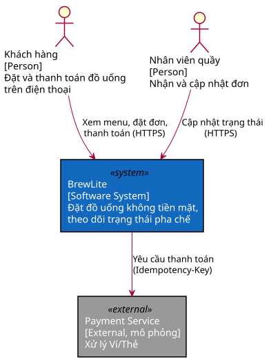
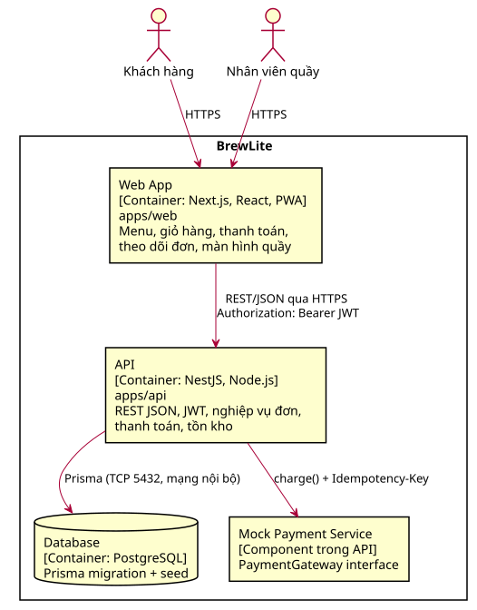

# Kiến trúc BrewLite (Task 3.1)

Phương pháp: **C4** (mức Context và Container) kết hợp **kiến trúc phân lớp** bên trong backend. Mỗi quyết định quan trọng được ghi thành ADR trong [`adr/`](adr/).

## 1. C4 mức 1 – System Context

 – nguồn [c4-context.puml](c4-context.puml)

Khách hàng và nhân viên quầy dùng BrewLite qua trình duyệt (HTTPS). BrewLite gọi dịch vụ thanh toán mô phỏng để xử lý Ví/Thẻ.

## 2. C4 mức 2 – Container

 – nguồn [c4-container.puml](c4-container.puml)

| Container | Công nghệ | Thư mục | Trách nhiệm |
|---|---|---|---|
| Web App | Next.js (App Router), React, TypeScript, Tailwind; PWA manifest | `apps/web` | Giao diện mobile-first: menu, chi tiết, giỏ (lưu localStorage), đăng nhập, thanh toán, theo dõi đơn (poll 5 giây), màn hình quầy `/staff` |
| API | NestJS, TypeScript, class-validator, Passport JWT, bcrypt | `apps/api` | REST JSON, xác thực, nghiệp vụ đơn, state machine, thanh toán idempotent, tồn kho, khuyến mãi, điểm thưởng, `/health` |
| Database | PostgreSQL 16 + Prisma migration/seed | `apps/api/prisma` | Lưu user, sản phẩm, đơn, payment, khuyến mãi, nguyên liệu |
| Mock Payment Service | Hàm `mockGatewayApproves` + trang `/mock-pay`, chọn bằng `PAYMENT_PROVIDER=mock` | `apps/api/src/payments` | Mô phỏng trừ tiền Ví/Thẻ, trả SUCCEEDED/FAILED (ADR-008) |

## 3. Phân lớp trong backend (ADR-002)

```
HTTP request
  → Guard (JwtAuthGuard, RolesGuard)      kiểm tra JWT, role STAFF/ADMIN
  → Pipe (ValidationPipe, whitelist)      validate DTO
  → Controller                            ánh xạ route ↔ service, không chứa nghiệp vụ
  → Service                               nghiệp vụ, transaction, state machine
  → PrismaService (repository)            truy cập PostgreSQL
Exception filter chung → JSON { statusCode, message } ; log mỗi request
```

| Module | Endpoint chính | Yêu cầu |
|---|---|---|
| `products` | `GET /products`, `GET /products/:id`, `GET /toppings` | FR-01, FR-02 |
| `auth` | `POST /auth/register`, `POST /auth/login`, `GET /auth/me` | FR-04 |
| `orders` | `POST /orders`, `GET /orders/me`, `GET /orders/:code`, `POST /orders/:code/cancel` | FR-05, FR-08, FR-09, FR-14 |
| `staff` (trong orders) | `GET /staff/orders`, `PATCH /orders/:code/status` | FR-10 |
| `payments` | `POST /api/payment/create/:code` (header `Idempotency-Key`), `POST /api/payment/mock/confirm` | FR-06, FR-07, FR-12 |
| `promotions` (trong orders) | `POST /orders/validate-promotion` | FR-11 |
| `inventory` | dùng nội bộ khi tạo/hủy/hoàn tất đơn | FR-13 |
| `health` | `GET /health` | NFR-04 |

Frontend cũng chia lớp: `app/` (route, trang) → `components/` (UI) → `lib/api.ts` (gọi REST, gắn JWT và Idempotency-Key) → `context/` (giỏ hàng, phiên đăng nhập).

## 4. Logging, health check và quản lý cấu hình

- **Logging:** NestJS `Logger` ghi ra stdout dạng một dòng/request (method, path, status, thời gian, requestId); không ghi mật khẩu, token. Render/Vercel thu stdout làm log.
- **Health check:** `GET /health` trả `{ status: "ok", db: "up", version: <GIT_SHA> }`, chạy `SELECT 1` tới DB; trả 503 nếu DB lỗi. Dùng cho Docker `HEALTHCHECK`, Render health check và smoke test sau deploy.
- **Cấu hình:** `@nestjs/config` đọc biến môi trường, validate khi khởi động (thiếu `DATABASE_URL`/`JWT_SECRET` thì dừng). `.env.example` liệt kê đủ biến nhưng không có giá trị thật. Web chỉ nhận biến công khai `NEXT_PUBLIC_API_URL`.

## 5. Lý do chọn, ưu điểm, hạn chế và trade-off

| Quyết định | Lý do | Ưu điểm | Hạn chế / trade-off | ADR |
|---|---|---|---|---|
| Monorepo | Đề yêu cầu `apps/`, `docs/` chung | Truy vết dễ, một PR đổi nhiều phần | Lịch sử chung, cần quy ước commit | 001 |
| Monolith NestJS phân lớp theo module | Quy mô nhỏ, một DB, 6 người | Đơn giản, test dễ, deploy một container | Không scale riêng từng module | 002 |
| State machine tập trung + UPDATE có điều kiện | Nhiều nơi đổi trạng thái, tranh chấp | Chặn chuyển sai, chống bấm trùng | Thêm trạng thái phải sửa nhiều sơ đồ | 003 |
| Idempotency-Key + UNIQUE | Chống trừ tiền 2 lần | Đúng cả khi đồng thời | Phải dọn payment PENDING treo | 004 |
| Optimistic locking cho kho | Đặt đồng thời | Không khóa dài | Có thể báo thử lại khi tranh chấp cao | 005 |
| Vercel + Render + GHCR | Miễn phí, HTTPS sẵn | Image theo SHA, rollback được | Cold start, rollback 2 nơi | 006 |
| Prisma migration | Tái tạo DB ở mọi môi trường | Schema trong Git | SQL đặc thù viết raw | 007 |
| Mock payment sau interface | Đề yêu cầu mô phỏng | Test được nhánh lỗi, không cần mạng | Không kiểm chứng cổng thật | 008 |

## 6. Danh sách ADR

| Mã | Quyết định | Tệp |
|---|---|---|
| ADR-001 | Monorepo `apps/web`, `apps/api`, `docs` | [adr/001-monorepo.md](adr/001-monorepo.md) |
| ADR-002 | NestJS phân lớp, module theo domain | [adr/002-layered-nestjs-modules.md](adr/002-layered-nestjs-modules.md) |
| ADR-003 | State machine trạng thái đơn | [adr/003-order-state-machine.md](adr/003-order-state-machine.md) |
| ADR-004 | Thanh toán idempotent | [adr/004-idempotent-payment.md](adr/004-idempotent-payment.md) |
| ADR-005 | Tồn kho: transaction + optimistic locking | [adr/005-inventory-optimistic-locking.md](adr/005-inventory-optimistic-locking.md) |
| ADR-006 | Triển khai Vercel + Render + GHCR | [adr/006-deploy-vercel-render-ghcr.md](adr/006-deploy-vercel-render-ghcr.md) |
| ADR-007 | Prisma migration | [adr/007-prisma-migration.md](adr/007-prisma-migration.md) |
| ADR-008 | Mock payment gateway | [adr/008-mock-payment-gateway.md](adr/008-mock-payment-gateway.md) |
