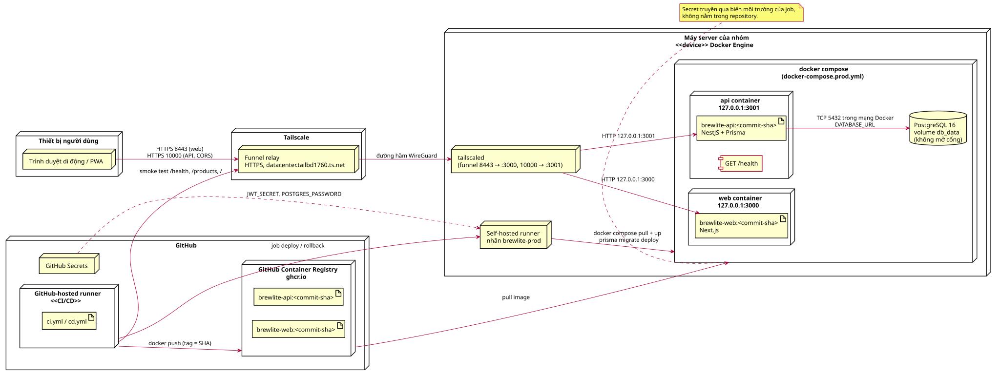
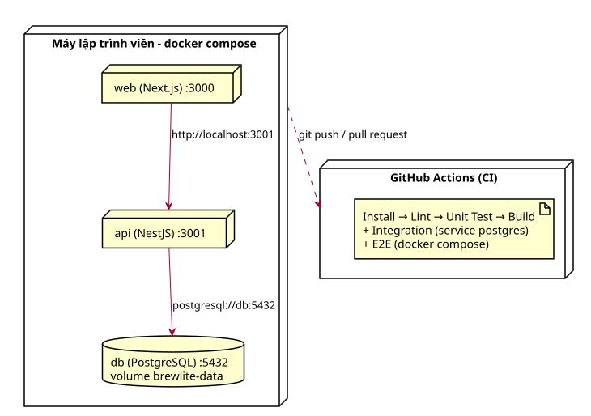

# Deployment diagram – production (Task 3.2)

 – nguồn [deployment.puml](deployment.puml)

Nền tảng theo [ADR-006](adr/006-deploy-tailscale-funnel-ghcr.md): máy server của nhóm chạy Docker Compose, công khai bằng Tailscale Funnel; GitHub Container Registry và GitHub Actions (runner của GitHub + self-hosted runner trên máy server).

## 1. Node, artifact và kết nối

| Node | Nền tảng | Cổng / giao thức | Artifact |
|---|---|---|---|
| Thiết bị người dùng | Trình duyệt di động / PWA | HTTPS 8443 (web), 10000 (API) tới `datacenter.tailbd1760.ts.net` | – |
| Tailscale Funnel | Relay của Tailscale, chứng chỉ `*.ts.net` | HTTPS công khai → đường hầm WireGuard tới `tailscaled` | – |
| Web | Container trên máy server | `127.0.0.1:3000`, chỉ Funnel truy cập | Image `ghcr.io/dinh-hung-116/brewlite-web:<commit-sha>` từ `apps/web/Dockerfile` |
| API | Container trên máy server | `127.0.0.1:3001`, chỉ Funnel truy cập | Image `ghcr.io/dinh-hung-116/brewlite-api:<commit-sha>` từ `apps/api/Dockerfile` |
| Database | PostgreSQL 16 trong Docker, volume `db_data` | TCP 5432 trong mạng Docker, không mở cổng | Schema từ `apps/api/prisma/migrations` |
| Container registry | GitHub Container Registry | HTTPS (docker push/pull) | Image API và web gắn tag SHA và `stable` |
| CI/CD | Runner của GitHub + self-hosted runner `brewlite-prod` | HTTPS tới GHCR, URL Funnel | `.github/workflows/ci.yml`, `cd.yml`, `docker-compose.prod.yml` |

## 2. Biến môi trường và secret

| Biến | Nơi khai báo | Dùng bởi |
|---|---|---|
| `JWT_SECRET`, `POSTGRES_PASSWORD` | GitHub Secrets → env của job deploy | API, PostgreSQL |
| `DATABASE_URL` | Ghép trong `docker-compose.prod.yml` từ `POSTGRES_PASSWORD` | API, `prisma migrate deploy` |
| `WEB_URL` (→ `CORS_ORIGIN`, `FRONTEND_URL`), `API_URL` | GitHub Variables | API, smoke test |
| `NEXT_PUBLIC_API_URL` | Build arg = `API_URL` trong `cd.yml` | Web |
| `GIT_SHA` | Build arg trong `cd.yml` | API `/health` |
| `PAYMENT_PROVIDER=mock` | `docker-compose.prod.yml` | API |
| `GITHUB_TOKEN` (packages: write) | Tự cấp cho workflow | Push/pull image GHCR |

Repository chỉ có `.env.example`; secret không in ra log (GitHub tự che giá trị secret).

## 3. Health check và log

- Docker `HEALTHCHECK` gọi `GET /health`; API trả `{status, db, version}` (HTTP 200 khi DB up, 503 khi DB lỗi), `version` là commit SHA. `docker compose up --wait` chỉ xong khi API healthy.
- Sau deploy, job `smoke-test` chạy trên runner của GitHub, gọi `/health` (đúng SHA vừa deploy), `/products` và trang `/` qua URL Funnel công khai; lỗi thì job `rollback` chạy lại image `stable`.
- Log: `docker compose -f docker-compose.prod.yml logs api web` trên máy server; log pipeline trên GitHub Actions.

## 4. Ranh giới Local, CI và Production

 – nguồn [deployment-local.puml](deployment-local.puml)

| Môi trường | Chạy ở đâu | DB | Secret |
|---|---|---|---|
| Local | `docker compose up --build` (web :3000, api :3001, db :5432) | Container Postgres + volume, seed mẫu | File `.env` local (không commit) |
| CI | GitHub Actions khi mở PR: Install → Lint → Unit Test → Build, integration test với service Postgres, E2E với docker compose | Postgres tạm, xóa sau job | Giá trị test cố định trong workflow |
| Production | Máy server của nhóm (Docker Compose) + Tailscale Funnel, deploy khi merge vào `main` / tag `v*` | PostgreSQL trong Docker, không mở cổng | GitHub Secrets truyền vào job deploy |

## 5. Truy vết node → kiến trúc → mã nguồn

| Node | Container (C4) | Mã nguồn |
|---|---|---|
| Web container – Next.js | Web App | `apps/web`, `apps/web/Dockerfile` |
| API container – NestJS | API, Mock Payment Service | `apps/api/src`, `apps/api/Dockerfile` |
| PostgreSQL container | Database | `apps/api/prisma/schema.prisma`, `prisma/migrations` |
| Tailscale Funnel | – (hạ tầng mạng) | `docker-compose.prod.yml` (bind 127.0.0.1), `docs/deployment.md` |
| GHCR | – (artifact) | `.github/workflows/cd.yml` (job build-push) |
| GitHub Actions | – (CI/CD) | `.github/workflows/ci.yml`, `cd.yml` |
