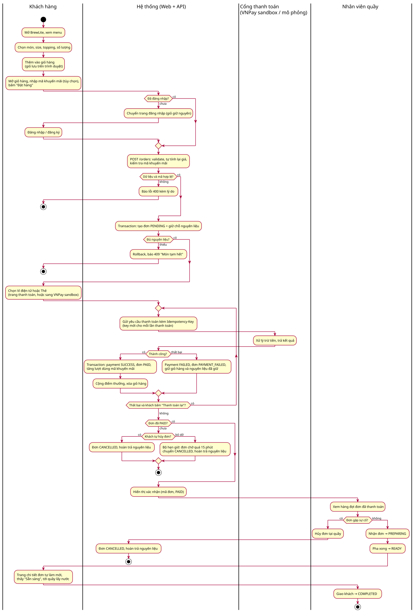
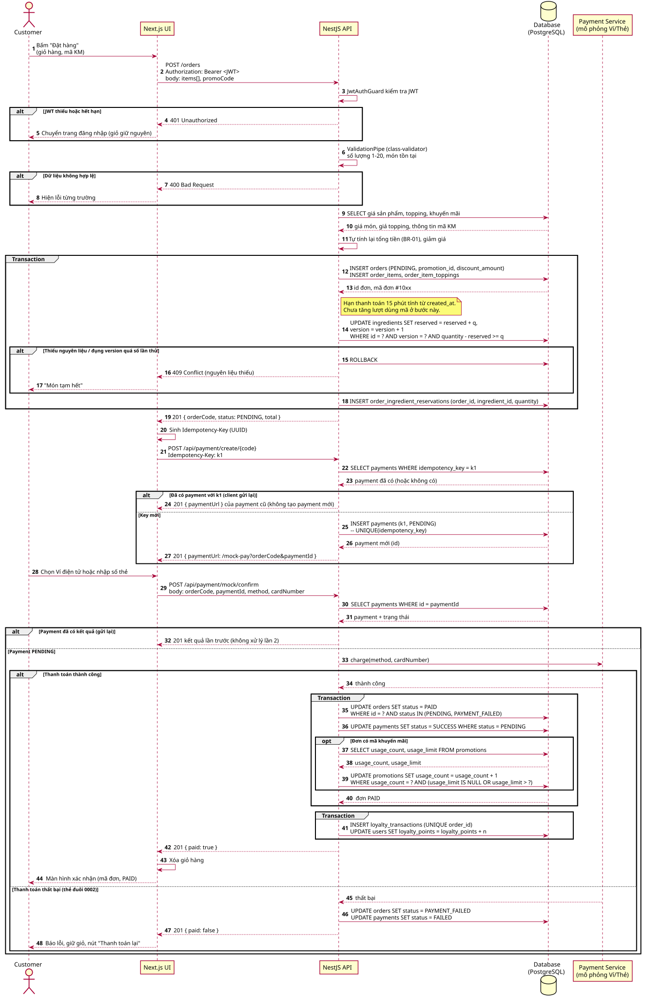
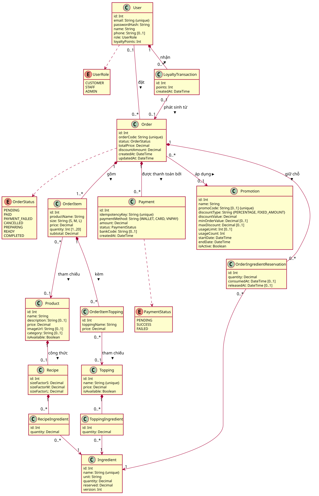

# Sơ đồ (Task 1 và Task 2)

Mỗi sơ đồ có file nguồn PlantUML (`.puml`) và ảnh kết xuất (`.svg`). Sinh lại ảnh sau khi sửa nguồn:

```bash
plantuml -tsvg docs/diagrams/*.puml
```

| Mã | Sơ đồ | Nguồn | Ảnh | Task |
|---|---|---|---|---|
| UC-00 | Use case tổng quát | [use-case-overview.puml](use-case-overview.puml) | [svg](use-case-overview.svg) | 1.2 |
| UC-01D | Use case Đặt và thanh toán | [use-case-checkout.puml](use-case-checkout.puml) | [svg](use-case-checkout.svg) | 1.3 |
| Activity-01 | Luồng end-to-end menu → thanh toán → nhận nước | [activity-checkout.puml](activity-checkout.puml) | [svg](activity-checkout.svg) | 2.1 |
| Sequence-01 | Đặt và thanh toán (UC-06 + UC-08) | [sequence-checkout.puml](sequence-checkout.puml) | [svg](sequence-checkout.svg) | 2.2 |
| Class-01 | Class diagram mức domain | [class-domain.puml](class-domain.puml) | [svg](class-domain.svg) | 2.3 |

## Activity-01



Có điểm bắt đầu/kết thúc, 4 swimlane (Khách hàng, Hệ thống, Cổng thanh toán mô phỏng, Nhân viên quầy), decision/merge cho các nhánh: **hết hàng**, **chưa đăng nhập**, dữ liệu/mã không hợp lệ, thiếu nguyên liệu khi tạo đơn, **thanh toán thất bại** (thanh toán lại hoặc hết hạn 15 phút).

## Sequence-01



Lifeline: Customer → Next.js UI → NestJS API → Database → Payment Service. Thể hiện thứ tự gọi `POST /orders` rồi `POST /payments`; kiểm tra JWT (bước 3) và validate (bước 6); transaction tạo đơn + giữ nguyên liệu với optimistic locking (bước 11–16); `alt` thanh toán thành công/thất bại; idempotency khi client gửi lại cùng `Idempotency-Key` (bước 20–21); thông báo kết quả cuối cho người dùng.

## Class-01



Đủ 7 lớp bắt buộc (User, Product, Order, OrderItem, Payment, Promotion, LoyaltyTransaction) cùng Topping, Ingredient; có thuộc tính chính, quan hệ, multiplicity và enum `OrderStatus`, `PaymentStatus`, `Role`, `Size`, `PaymentMethod`, `DiscountType`.

## Kiểm tra nhất quán (tiêu chí nghiệm thu Task 2)

| Kiểm tra | Sơ đồ / tài liệu | Kết quả |
|---|---|---|
| 7 trạng thái đơn và các mũi tên chuyển | SRS BR-06, Class-01 `OrderStatus`, Activity-01, Sequence-01 | Khớp: Sequence chỉ dùng PENDING → PAID/PAYMENT_FAILED; Activity thêm PREPARING → READY → COMPLETED và CANCELLED khi hết hạn |
| Giới hạn số lượng 1–20 | SRS FR-02, BR-02; Class-01 `OrderItem.quantity [1..20]`; Sequence bước 6 | Khớp |
| Idempotency | SRS FR-07; UC E4; Sequence bước 18–22; Class-01 `Payment.idempotencyKey {unique}` | Khớp |
| Giữ nguyên liệu, chống bán quá kho | SRS FR-13, BR-04; UC E3; Activity "Đủ nguyên liệu?"; Sequence transaction; Class-01 `Ingredient.version` | Khớp |
| Khuyến mãi, điểm thưởng | SRS FR-11, FR-12, BR-03; UC-07 «extend»; Sequence bước 16, 27; Class-01 Promotion, LoyaltyTransaction | Khớp |
| Actor của use case ↔ lifeline/swimlane | Use case (Khách hàng, Cổng thanh toán, Nhân viên quầy) ↔ Activity swimlane ↔ Sequence lifeline | Khớp; Nhân viên quầy không có trong Sequence vì nằm ngoài UC-06 + UC-08 |
| Phương thức thanh toán Ví/Thẻ mô phỏng | SRS FR-06; UC-08; Class-01 `PaymentMethod` | Khớp |
| Mô hình dữ liệu | Class-01 ↔ `apps/api/prisma/schema.prisma` (Task 4–5) | Kiểm lại khi hiện thực; mọi thay đổi phải cập nhật Class-01 qua PR |
