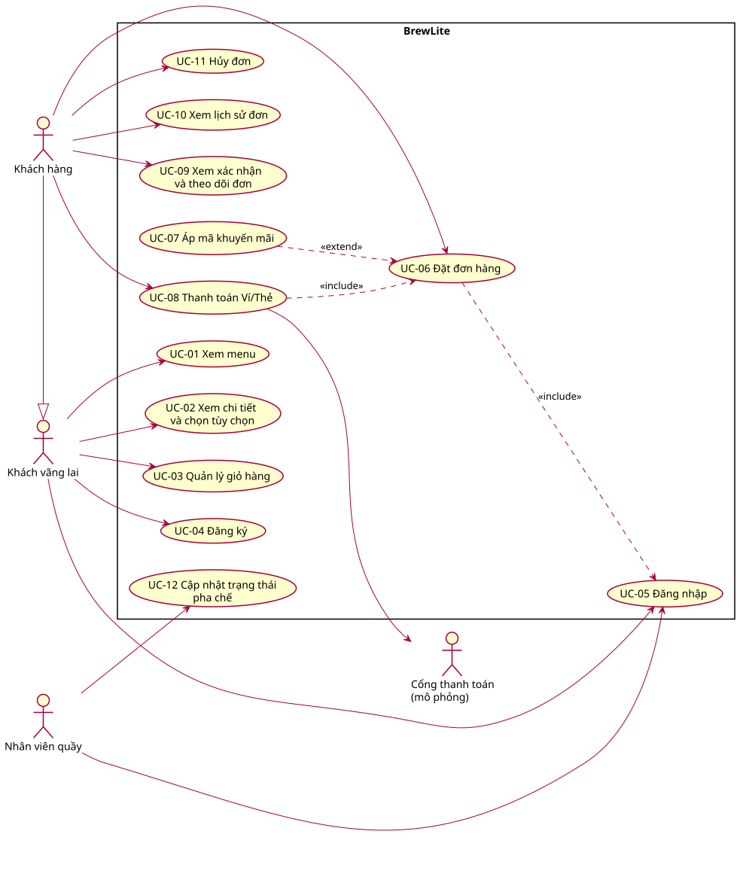

# Đặc tả yêu cầu phần mềm rút gọn (SRS) – Task 1.2

Phạm vi và stakeholder: xem [context-and-scope.md](context-and-scope.md). Mức ưu tiên theo MoSCoW: **M**ust, **S**hould, **C**ould, **W**on't. Mã kiểm thử ở cột cuối được dùng lại trong `docs/traceability-matrix.md` (Task 5).

## 1. Yêu cầu chức năng

| Mã | Nhóm | Yêu cầu | MoSCoW | Tiêu chí chấp nhận (kiểm chứng được) |
|---|---|---|---|---|
| FR-01 | Menu | Hệ thống hiển thị danh sách đồ uống đang bán gồm ảnh, tên, giá khởi điểm, danh mục. | M | `GET /products` trả 200 và mảng JSON có `id, name, price, imageUrl, category`; trang `/` hiển thị lưới sản phẩm; có trạng thái loading, rỗng ("Chưa có món"), lỗi (có nút Thử lại). |
| FR-02 | Chi tiết sản phẩm | Khách xem chi tiết món, chọn size S/M/L, chọn 0..n topping, số lượng 1–20; giá cập nhật ngay. | M | `GET /products/:id` trả 200, id không tồn tại trả 404. Giá = (giá gốc + phụ thu size + Σ topping) × số lượng, phụ thu S 0đ, M 5.000đ, L 10.000đ (BR-01). |
| FR-03 | Giỏ hàng | Khách thêm, sửa số lượng, xóa món; tổng tiền và badge số lượng tự cập nhật; giỏ còn sau khi tải lại trang. | M | Thêm 2 món khác tùy chọn tạo 2 dòng; cùng tùy chọn thì cộng số lượng; tải lại trang giỏ không mất. |
| FR-04 | Xác thực | Đăng ký bằng email + mật khẩu (≥ 6 ký tự), đăng nhập nhận JWT; route đặt đơn, thanh toán, lịch sử yêu cầu JWT. | M | `POST /auth/register` trả 201, email trùng 409; `POST /auth/login` sai mật khẩu 401; gọi `POST /orders` không token trả 401. |
| FR-05 | Đặt đơn | Khách đã đăng nhập tạo đơn từ giỏ; backend validate và tự tính lại giá từ CSDL; đơn ở trạng thái PENDING, có mã đơn. | M | `POST /orders` trả 201 với `orderCode` dạng `#1001`, `status = PENDING`, `total` đúng theo BR-01 dù client gửi giá sai; giỏ rỗng hoặc số lượng ngoài 1–20 trả 400. |
| FR-06 | Thanh toán | Khách thanh toán đơn PENDING bằng Ví điện tử hoặc Thẻ qua dịch vụ thanh toán **mô phỏng**; thành công → PAID, thất bại → PAYMENT_FAILED, cho thanh toán lại. | M | `POST /payments` với thẻ đuôi `0002` trả kết quả FAILED và đơn PAYMENT_FAILED, giỏ giữ nguyên; thẻ/ví hợp lệ trả SUCCEEDED và đơn PAID. |
| FR-07 | Thanh toán idempotent | Mỗi lần bấm thanh toán gửi một `Idempotency-Key`; gửi lại cùng key không tạo thêm giao dịch. | M | Gửi 2 request cùng key (kể cả đồng thời) → bảng `payments` chỉ có 1 bản ghi, response giống nhau. |
| FR-08 | Xác nhận và theo dõi | Sau thanh toán hiển thị mã đơn, trạng thái, tổng tiền; trang chi tiết đơn tự cập nhật trạng thái. | M | Trang `/orders/[code]` đổi từ PAID sang PREPARING trong ≤ 10 giây sau khi quầy bấm "Nhận đơn". |
| FR-09 | Lịch sử đơn | Khách xem danh sách đơn của chính mình, mới nhất trước. | M | `GET /orders/me` chỉ trả đơn của user trong JWT; xem đơn của người khác trả 404. |
| FR-10 | Quản lý trạng thái đơn | Nhân viên quầy xem hàng đợi đơn đã thanh toán và chuyển PAID → PREPARING → READY → COMPLETED; chặn chuyển sai. | M | `PATCH /orders/:code/status` với chuyển tiếp không hợp lệ (vd PAID → READY) trả 409; role CUSTOMER gọi trả 403; 2 nhân viên cùng bấm chỉ 1 thành công. |
| FR-11 | Khuyến mãi | Khách nhập mã giảm giá (% hoặc số tiền, có đơn tối thiểu, giảm tối đa, hạn dùng, số lượt). | S | Mã `WELCOME10` giảm 10% đơn ≥ 50.000đ, tối đa 30.000đ; mã hết hạn/hết lượt/chưa đủ tối thiểu trả 400 kèm lý do. |
| FR-12 | Điểm thưởng | Đơn chuyển PAID thì cộng 1 điểm cho mỗi 10.000đ (BR-03); chỉ cộng một lần. | S | Đơn 55.800đ cộng 5 điểm; callback/thanh toán gửi lặp không cộng thêm. |
| FR-13 | Tồn kho nguyên liệu | Khi đặt đơn, hệ thống giữ chỗ nguyên liệu theo công thức và size; không cho đặt vượt tồn kho kể cả khi đặt đồng thời. | S | Kho còn đủ cho 1 ly mà 2 khách đặt cùng lúc → 1 đơn thành công, 1 đơn nhận 409 kèm tên nguyên liệu thiếu. |
| FR-14 | Hủy đơn | Khách hủy đơn PENDING/PAYMENT_FAILED; đơn PENDING quá 15 phút tự hủy (BR-05); nguyên liệu và lượt mã được trả lại. | S | `POST /orders/:code/cancel` trên đơn PREPARING trả 409; sau 15 phút đơn PENDING thành CANCELLED. |
| FR-15 | PWA | Có thể "Thêm vào màn hình chính" trên điện thoại. | C | Lighthouse nhận diện được web app manifest và icon. |
| FR-16 | Thông báo đẩy | Báo khi đồ uống sẵn sàng qua push/SMS. | W | Không thực hiện trong Assignment 2. |

## 2. Yêu cầu phi chức năng

| Mã | Nhóm | Yêu cầu | MoSCoW | Cách kiểm chứng |
|---|---|---|---|---|
| NFR-01 | Hiệu năng | API đọc (`/products`, `/orders/me`) có thời gian phản hồi p95 < 500 ms với dữ liệu mẫu; trang menu hiển thị nội dung < 3 giây trên 4G. | M | Integration test đo thời gian; Lighthouse mobile. |
| NFR-02 | Bảo mật | Mật khẩu băm bcrypt; JWT hết hạn 24h; validate mọi input (class-validator, whitelist); API quầy chỉ cho STAFF/ADMIN; secret không nằm trong repo/log; HTTPS ở production. | M | Unit test guard; review `.env.example`; kiểm tra log CI; truy cập HTTP bị chuyển HTTPS. |
| NFR-03 | Tính dễ dùng (mobile-first) | Giao diện dùng tốt ở màn hình 360–430 px, thao tác chính ≤ 3 chạm từ menu đến giỏ. | M | E2E Playwright với thiết bị giả lập điện thoại. |
| NFR-04 | Tính khả dụng | Có `GET /health` kiểm tra kết nối DB; production trả 200 khi chấm; lỗi deploy được phát hiện và rollback. | M | Smoke test trong pipeline CD gọi `/health`. |
| NFR-05 | Toàn vẹn dữ liệu | Chuyển trạng thái đơn đi qua state machine; tạo đơn + giữ nguyên liệu trong một transaction; thanh toán idempotent. | M | Unit/integration test tiêu chí (a) chặn chuyển sai, (b) trùng Idempotency-Key, (c) đặt đồng thời không vượt kho. |
| NFR-06 | Khả năng triển khai | `docker compose up --build` chạy web, API, DB ở local; migration + seed tái tạo DB; CI/CD tự động, image gắn tag commit SHA. | M | Người ngoài nhóm chạy theo README; log pipeline. |
| NFR-07 | Khả năng bảo trì | Backend chia module theo domain; lint không lỗi; mỗi thay đổi đi qua PR có review. | S | CI lint; lịch sử PR. |

## 3. Quy tắc nghiệp vụ

- **BR-01** Giá một ly = giá gốc + phụ thu size (S 0đ, M 5.000đ, L 10.000đ) + tổng giá topping; backend luôn tự tính lại.
- **BR-02** Mỗi món tối đa 20 ly trong một đơn.
- **BR-03** 1 điểm thưởng cho mỗi 10.000đ của đơn đã thanh toán (làm tròn xuống).
- **BR-04** Nguyên liệu được giữ chỗ khi tạo đơn, trừ hẳn khi đơn COMPLETED, trả lại khi đơn CANCELLED.
- **BR-05** Hạn thanh toán 15 phút kể từ lúc tạo đơn, không gia hạn khi thanh toán lỗi.
- **BR-06** Trạng thái đơn chỉ đi theo các mũi tên: PENDING → PAID/PAYMENT_FAILED/CANCELLED; PAYMENT_FAILED → PENDING/CANCELLED; PAID → PREPARING/CANCELLED; PREPARING → READY; READY → COMPLETED.

## 4. Biểu đồ use case tổng quát

Nguồn: [`docs/diagrams/use-case-overview.puml`](../diagrams/use-case-overview.puml) – ảnh: [`use-case-overview.svg`](../diagrams/use-case-overview.svg).

| Mã | Use case | Actor | Yêu cầu |
|---|---|---|---|
| UC-01 | Xem menu | Khách vãng lai | FR-01 |
| UC-02 | Xem chi tiết và chọn tùy chọn | Khách vãng lai | FR-02 |
| UC-03 | Quản lý giỏ hàng | Khách vãng lai | FR-03 |
| UC-04 | Đăng ký tài khoản | Khách vãng lai | FR-04 |
| UC-05 | Đăng nhập | Khách vãng lai, Nhân viên quầy | FR-04 |
| UC-06 | Đặt đơn hàng | Khách hàng | FR-05, FR-13 |
| UC-07 | Áp mã khuyến mãi («extend» UC-06) | Khách hàng | FR-11 |
| UC-08 | Thanh toán Ví/Thẻ | Khách hàng, Cổng thanh toán mô phỏng | FR-06, FR-07, FR-12 |
| UC-09 | Xem xác nhận và theo dõi đơn | Khách hàng | FR-08 |
| UC-10 | Xem lịch sử đơn | Khách hàng | FR-09 |
| UC-11 | Hủy đơn | Khách hàng | FR-14 |
| UC-12 | Cập nhật trạng thái pha chế | Nhân viên quầy | FR-10 |

Khách hàng kế thừa Khách vãng lai. Use case trọng tâm UC-06 + UC-08 được đặc tả ở [use-case-checkout.md](use-case-checkout.md).
