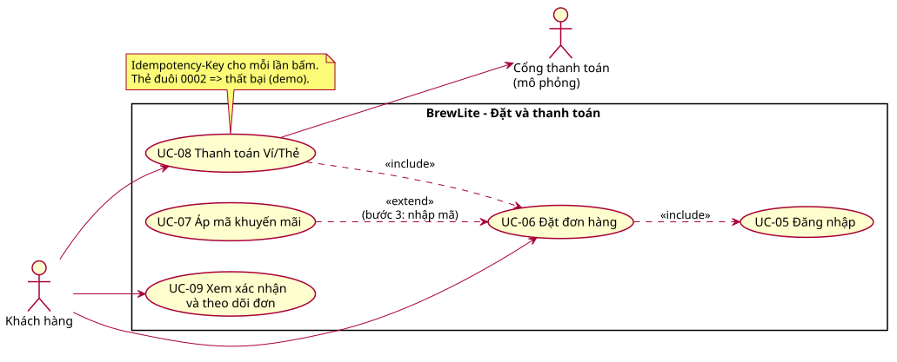

# Đặc tả use case trọng tâm – UC-06 + UC-08: Đặt và thanh toán đơn hàng (Task 1.3)

## 1. Use case diagram cho phạm vi đã chọn

Nguồn: [`docs/diagrams/use-case-checkout.puml`](../diagrams/use-case-checkout.puml)

## 2. Đặc tả

| Mục | Nội dung |
|---|---|
| Mã use case | UC-06 + UC-08 |
| Tên | Đặt và thanh toán đơn hàng (UC-06 Đặt đơn hàng gộp với UC-08 Thanh toán đơn thành một luồng) |
| Actor chính | Khách hàng (đã đăng nhập) |
| Actor phụ | Cổng thanh toán: VNPay sandbox hoặc cổng mô phỏng Ví/Thẻ (Mock Payment Service, mặc định khi demo) |
| Tóm tắt | Khách đặt các món trong giỏ và thanh toán xong để quầy bắt đầu pha chế. |
| Trigger | Khách bấm "Thanh toán" ở trang giỏ hàng. |
| Tiền điều kiện | Giỏ hàng có ít nhất 1 món; khách đã đăng nhập (chưa thì chuyển sang đăng nhập rồi quay lại); các món còn bán. |
| Hậu điều kiện – thành công | Đơn PAID; nguyên liệu đã được giữ chỗ; có đúng 1 giao dịch SUCCEEDED; khách được cộng điểm; giỏ hàng được xóa. |
| Hậu điều kiện – thất bại | Đơn PAYMENT_FAILED, giỏ giữ nguyên, khách thanh toán lại được cùng đơn trong hạn 15 phút; hoặc không tạo đơn nào nếu lỗi ở bước tạo đơn. |
| Quan hệ | UC-06 «include» UC-05 Đăng nhập; UC-07 Áp mã khuyến mãi «extend» UC-06 tại bước 3; UC-08 «include» UC-06 và UC-17 Cộng điểm thưởng; UC-06 «include» UC-18 Giữ chỗ nguyên liệu; UC-13 Thanh toán lại «include» UC-08. User Story A1: US-05, US-06, US-07, US-08, US-09, US-16, US-18. |
| Yêu cầu liên quan | FR-04, FR-05, FR-06, FR-07, FR-08, FR-11, FR-12, FR-13, FR-14; NFR-01, NFR-02, NFR-05 |

### 2.1 Luồng chính

| Bước | Actor | Hệ thống |
|---|---|---|
| 1 | Bấm "Thanh toán" ở trang giỏ hàng. *(A1)* | |
| 2 | | Hiển thị trang thanh toán: các món, size, topping, tổng tiền. |
| 3 | Nhập mã khuyến mãi (không bắt buộc), chọn Ví điện tử hoặc Thẻ. *(A2)* | |
| 4 | Bấm "Xác nhận thanh toán". | |
| 5 | | Kiểm tra JWT và dữ liệu, tự tính lại giá từ CSDL, kiểm tra và giữ một lượt mã khuyến mãi. *(A4, E1, E2)* |
| 6 | | Trong một transaction: giữ chỗ nguyên liệu theo công thức, lưu đơn PENDING với hạn thanh toán 15 phút. *(E3)* |
| 7 | | Gửi yêu cầu thanh toán kèm `Idempotency-Key` tới cổng thanh toán mô phỏng. *(E4, E5)* |
| 8 | | Cổng báo thành công: lưu giao dịch SUCCEEDED, chuyển đơn sang PAID, cộng điểm thưởng. *(A3)* |
| 9 | | Xóa giỏ hàng, hiển thị màn hình xác nhận với mã đơn và trạng thái. |

### 2.2 Luồng thay thế

- **A1** Khách chưa đăng nhập: chuyển sang trang đăng nhập; đăng nhập xong quay lại bước 2.
- **A2** Khách không nhập mã: bỏ qua phần giảm giá ở bước 5.
- **A3** Cổng thanh toán báo thất bại (vd thẻ đuôi `0002`): lưu giao dịch FAILED, đơn chuyển PAYMENT_FAILED, giỏ giữ nguyên; khách bấm "Thanh toán lại" để quay lại bước 7 với cùng đơn và một `Idempotency-Key` mới.
- **A4** Đã có đơn chờ thanh toán từ lần trước và giỏ không đổi: dùng lại đơn đó, bỏ qua bước 5–6.

### 2.3 Luồng ngoại lệ

- **E1** Dữ liệu không hợp lệ (giỏ rỗng, số lượng ngoài 1–20, món không tồn tại hoặc ngừng bán): trả 400, không tạo đơn.
- **E2** Mã khuyến mãi không tồn tại, hết hạn, hết lượt hoặc đơn chưa đủ tối thiểu: báo lý do, không tạo đơn; khách bỏ mã hoặc nhập mã khác, quay lại bước 3.
- **E3** Thiếu nguyên liệu (kể cả khi nhiều khách đặt cùng lúc): trả 409 kèm tên nguyên liệu thiếu; rollback toàn bộ, không giữ nguyên liệu hay lượt mã.
- **E4** Mất mạng sau khi bấm và khách bấm lại: trình duyệt gửi lại cùng `Idempotency-Key`, hệ thống trả kết quả lần trước, không trừ tiền lần hai.
- **E5** Đơn đã quá hạn 15 phút: trả 409 "Đơn đã hết hạn thanh toán", không gọi cổng thanh toán; đơn chuyển CANCELLED, nguyên liệu và lượt mã được trả lại.
- **E6** Bất kỳ bước nào: phiên đăng nhập hết hạn (401) thì chuyển sang trang đăng nhập, giỏ giữ nguyên.

### 2.4 Quy tắc nghiệp vụ áp dụng

BR-01, BR-02, BR-03, BR-04, BR-05, BR-06 (xem [srs.md](srs.md#3-quy-tắc-nghiệp-vụ)).

## 3. Tiêu chí chấp nhận dùng để viết test (Task 5)

| Mã | Given / When / Then | Yêu cầu |
|---|---|---|
| AC-01 | Giỏ 2 món hợp lệ, khách đã đăng nhập, thẻ hợp lệ → đơn PAID, có 1 payment SUCCEEDED, giỏ rỗng, hiển thị mã đơn. | FR-05, FR-06, FR-08 |
| AC-02 | Thẻ đuôi `0002` → đơn PAYMENT_FAILED, giỏ còn nguyên, nút "Thanh toán lại" hiện. | FR-06 |
| AC-03 | Gửi 2 lần cùng `Idempotency-Key` → chỉ 1 payment, response giống nhau. | FR-07 |
| AC-04 | Client gửi giá 1đ → tổng tiền đơn vẫn tính theo CSDL. | FR-05 |
| AC-05 | 2 khách đặt đồng thời khi kho chỉ đủ 1 ly → 1 thành công, 1 nhận 409. | FR-13 |
| AC-06 | Không có JWT → `POST /orders` trả 401, UI chuyển trang đăng nhập. | FR-04 |
| AC-07 | Mã `WELCOME10` trên đơn 40.000đ → 400 "chưa đủ giá trị tối thiểu". | FR-11 |
